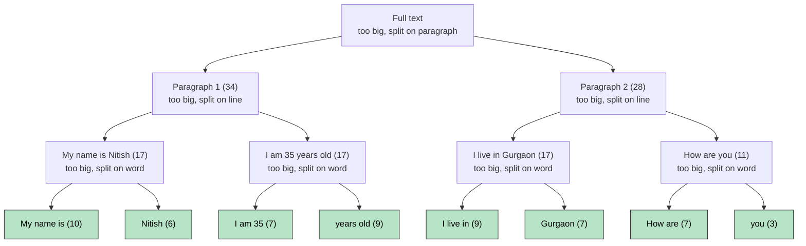
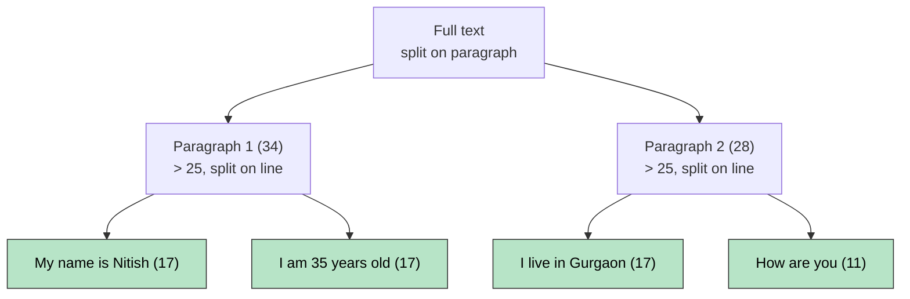
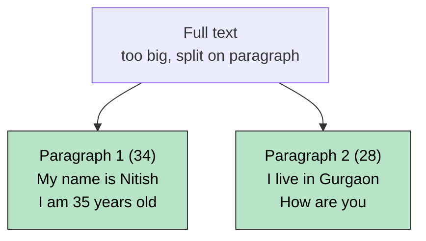

# Text Structure Based Splitting (RecursiveCharacterTextSplitter)

Splits text using its **natural structure** instead of cutting blindly by length. It tries to keep paragraphs, lines and words together, so chunks stay meaningful.

## Separators (tried in this order)

| Order | Separator | Splits at |
|---|---|---|
| 1 | `"\n\n"` | Paragraph |
| 2 | `"\n"` | Line |
| 3 | `" "` | Word |
| 4 | `""` | Character (last resort) |

## How It Works

1. Split the text on the **first** separator (paragraph).
2. If a piece is **still bigger than `chunk_size`**, split that piece with the **next** separator (line, then word, then character). This repeat is why it is called **recursive**.
3. **Merge** small neighbouring pieces back together as long as they stay within `chunk_size`.

Result: chunks are as large as allowed, but cut at the most natural boundary available.

## Example Text

```
My name is Nitish          (17)
I am 35 years old          (17)
                                    <- blank line = paragraph break
I live in Gurgaon          (17)
How are you                (11)
```

Counts are character lengths of each line (separator characters not counted, same as the lecture notes).

## Case 1: chunk_size = 10

Everything is bigger than 10, so it keeps splitting down to words, then merges words back up to 10 characters.



**Merging example (line 1):** words are `My (2)`, `name (4)`, `is (2)`, `Nitish (6)`.
`My` + `name` = 7, plus `is` = 10 (still fits) → chunk `My name is`.
Adding `Nitish` would exceed 10, so it becomes its own chunk.

**Final chunks (8):** `My name is` | `Nitish` | `I am 35` | `years old` | `I live in` | `Gurgaon` | `How are` | `you`

## Case 2: chunk_size = 25

Paragraphs (34 and 28) are too big, so they split into lines. Each line (17 or 11) now fits. Two lines **cannot be merged** (17 + 17 = 34 > 25), so no further splitting is needed.



**Final chunks (4):** one per line. Merging neighbours would exceed 25, so they stay separate.

## Case 3: chunk_size = 50

Each paragraph (34 and 28) already fits within 50, so splitting on paragraph is enough. The two paragraphs cannot merge (34 + 28 = 62 > 50).



**Final chunks (2):** one per paragraph.

## Takeaway from the 3 Cases

| chunk_size | Splits down to | Chunks |
|---|---|---|
| 10 | Words | 8 |
| 25 | Lines | 4 |
| 50 | Paragraphs | 2 |

A **bigger** `chunk_size` means fewer, larger chunks. A **smaller** one forces the splitter to go deeper into smaller separators.

## Code

```python
from langchain_text_splitters import RecursiveCharacterTextSplitter

splitter = RecursiveCharacterTextSplitter(
    chunk_size=10,
    chunk_overlap=0,
    # separators=["\n\n", "\n", " ", ""]   # default order
)

chunks = splitter.split_text(text)          # string -> list of strings
chunks = splitter.split_documents(docs)     # Documents -> list of Documents
```

## Advantages

- Keeps paragraphs, lines and words together as much as possible.
- Chunks carry more complete meaning, so embeddings are better than with length based splitting.
- Still guarantees chunks stay within `chunk_size`.

## Disadvantages

- Slightly slower than pure length based splitting.
- Only knows text structure (newlines, spaces), not the actual meaning of the text.

## Quick Summary

Recursive splitter = try paragraph, then line, then word, then character. Split only what is too big, then merge small pieces back up to `chunk_size`. It is the most commonly used splitter and a good default for RAG.