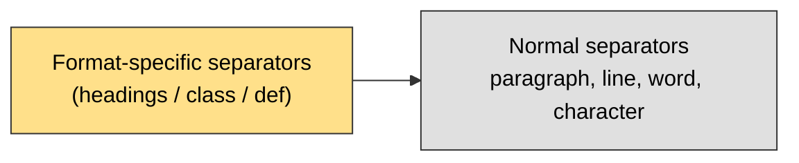

# Document Structure Based Splitting

Splits text using the **structure of the document format** (Markdown headings, code classes and functions, HTML tags), not just newlines and spaces.

It is the same `RecursiveCharacterTextSplitter`, but with **format-specific separators** tried in order, then the normal text separators as a fallback.



## 1. Markdown

Splits along headings first, so each section stays together.

| Priority | Separator | Meaning |
|---|---|---|
| 1 | `\n#{1,6} ` | Headings (level 1 to 6) |
| 2 | ` ```\n ` | End of a code block |
| 3 | `***`, `---`, `___` | Horizontal lines |
| 4 | `\n\n`, `\n`, ` `, `""` | Normal fallback |

## 2. Code (Python example)

Splits along class and function definitions first, so a function is not cut in half.

| Priority | Separator | Meaning |
|---|---|---|
| 1 | `\nclass ` | Class definition |
| 2 | `\ndef ` | Function definition |
| 3 | `\n\tdef ` | Method inside a class |
| 4 | `\n\n`, `\n`, ` `, `""` | Normal fallback |

## Code

```python
from langchain_text_splitters import RecursiveCharacterTextSplitter, Language

splitter = RecursiveCharacterTextSplitter.from_language(
    language=Language.PYTHON,     # or Language.MARKDOWN
    chunk_size=300,
    chunk_overlap=0,
)

chunks = splitter.split_text(text)
```

`Language` also supports JS, Java, C++, HTML and more. Print `RecursiveCharacterTextSplitter.get_separators_for_language(Language.PYTHON)` to see the exact separators.

## Why Use It

- Chunks follow the real structure (a section, a class, a function).
- Better chunks give better embeddings and better retrieval.
- Especially good for **code and Markdown docs**.

## Quick Summary

Document structure based = recursive splitter + separators from the file format (`#` headings for Markdown, `class` and `def` for code), with normal text separators as a fallback.