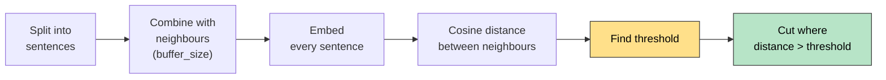

# Semantic Meaning Based Splitting (SemanticChunker)

Splits text where the **meaning changes**, not at a fixed size or separator.

> Lives in `langchain-experimental` (not the main splitters package). That package is archived/sunset, but it still works.
> `pip install langchain-experimental` → `from langchain_experimental.text_splitter import SemanticChunker`

## How It Works



- **Distance** = `1 - cosine similarity`. Big distance = different topic.
- A **big jump** in distance between two neighbouring sentences = topic changed = cut here.

```
Sentence:  S0   S1   S2   S3   S4   S5   S6   S7
Distance:    0.10 0.12 0.80 0.09 0.11 0.90 0.10
                       ↑                ↑
                     cut              cut
Chunks: [S0 S1 S2]  [S3 S4 S5]  [S6 S7]
```

## Threshold (what counts as a "big jump")

Calculated from the document's own distances, so it adapts to each text.

| `breakpoint_threshold_type` | Threshold | Default amount |
|---|---|---|
| `percentile` | Nth percentile of distances | 95 |
| `standard_deviation` | mean + amount × SD | 3 |
| `interquartile` | mean + amount × IQR | 1.5 |
| `gradient` | Percentile of the change between distances | 95 |

**Standard deviation formula:** `threshold = mean + amount × SD`

- **Mean** = the typical distance (where "normal" is).
- **SD** = how much distances normally vary (the step size).
- **Amount** = how many SDs above normal a jump must be to count.

## Parameters

| Parameter | Purpose |
|---|---|
| `embeddings` | Model that turns sentences into vectors (required) |
| `buffer_size` (1) | Neighbouring sentences joined before embedding, smooths noise |
| `breakpoint_threshold_type` | Rule for the threshold (table above) |
| `breakpoint_threshold_amount` | Strictness dial for that rule |
| `number_of_chunks` | Ask for roughly N chunks instead of a threshold |
| `sentence_split_regex` | How sentences are split (default: after `.` `?` `!`) |
| `min_chunk_size` | Smaller groups are merged into the next chunk (characters) |
| `add_start_index` | Adds an approximate `start_index` to metadata |

## Tuning the Amount

| Type | Lower amount | Higher amount |
|---|---|---|
| `percentile` | **More** cuts, small chunks | Fewer cuts, big chunks |
| `standard_deviation` | **More** cuts, small chunks | Fewer cuts, big chunks |

- Getting **one huge chunk**? Lower the amount.
- Getting **too many tiny chunks**? Raise the amount.
- `standard_deviation` with amount 3 needs **long documents**. On short text it rarely cuts.

## Code

```python
from langchain_experimental.text_splitter import SemanticChunker
from langchain_google_genai import GoogleGenerativeAIEmbeddings
from dotenv import load_dotenv

load_dotenv()

chunker = SemanticChunker(
    GoogleGenerativeAIEmbeddings(model="gemini-embedding-001"),
    breakpoint_threshold_type="percentile",
    breakpoint_threshold_amount=70,
)

chunks = chunker.split_text(text)              # list[str]
docs = chunker.create_documents([text])        # list[Document]
docs = chunker.split_documents(loaded_docs)    # keeps metadata
```

## Pros and Cons

| Pros | Cons |
|---|---|
| Chunks follow topics, so embeddings and retrieval are better | Slower and costlier: every sentence is embedded |
| No need to guess a chunk size | Uneven chunk sizes (some huge, some tiny) |
| | Needs tuning, and can hit API rate limits on big files |

## Quick Summary

Embed sentences → measure distance between neighbours → compute a threshold (`mean + amount × SD` for SD type) → cut where the distance jumps above it.