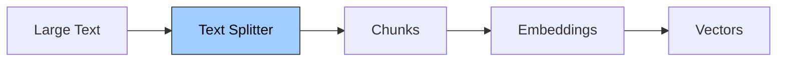
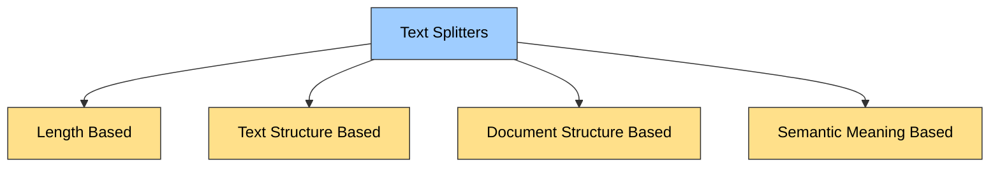

# Text Splitters

Large text is split into smaller **chunks** before it goes through the rest of the RAG pipeline.

## Why Do We Need Text Splitting?

### 1. Overcoming model limitations

Many embedding models and language models have **maximum input size constraints**. Splitting allows us to process documents that would otherwise exceed these limits.

- An LLM has a limited **context length** (e.g. 50K tokens, where tokens roughly correspond to words).
- A large PDF (for example, one you want to summarize) can be bigger than that limit, so it must be split into chunks first.

### 2. Downstream tasks

Text splitting improves nearly every LLM-powered task.

| Task | Why Splitting Helps |
|---|---|
| Embedding | Short chunks yield more accurate vectors |
| Semantic Search | Search results point to focused info, not noise |
| Summarization | Prevents hallucination and topic drift |

- **Embedding:** a whole document squeezed into one vector loses detail, while each small chunk gets its own accurate vector (text → vectors).

### 3. Optimizing computational resources

Working with smaller chunks of text can be more **memory-efficient** and allow for better **parallelization** of processing tasks.

## Flow

## Types of Text Splitters

| Type | Splits based on |
|---|---|
| **Length Based** | A fixed size (characters or tokens) |
| **Text Structure Based** | The natural structure of text (paragraphs, lines, sentences, words) |
| **Document Structure Based** | The structure of the document format (e.g. headings in Markdown, functions and classes in code, HTML tags) |
| **Semantic Meaning Based** | The meaning of the text, splitting where the topic changes |

## Quick Summary

- Models have input limits, so large text must be split.
- Smaller chunks give more accurate embeddings and cleaner search results.
- Smaller chunks use less memory and can be processed in parallel.
- Four approaches: length, text structure, document structure, semantic meaning.