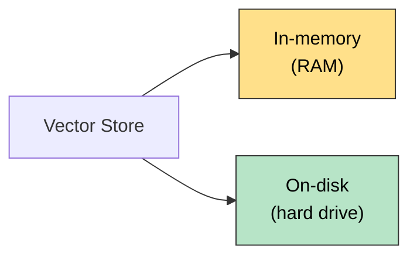
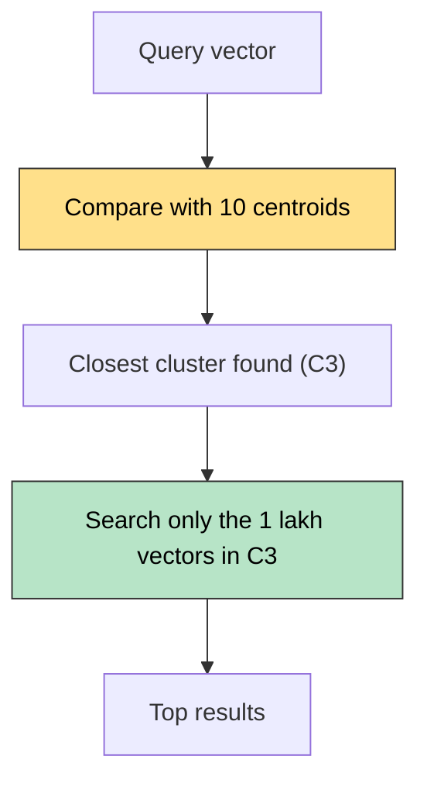
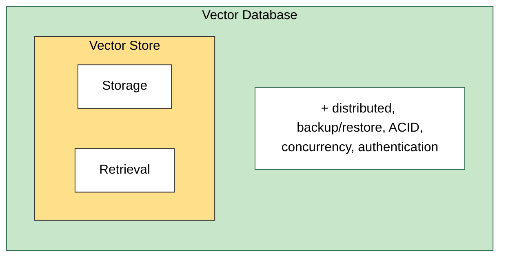
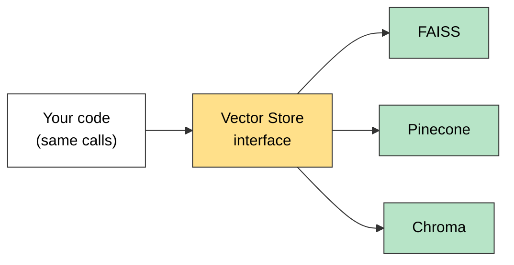

# What are Vector Stores

A **vector store** is a system designed to **store** and **retrieve** data represented as **numerical vectors**.

## Key Features

| # | Feature | Meaning |
|---|---|---|
| 1 | **Storage** | Keeps vectors and their associated **metadata**, either **in-memory** or **on-disk** |
| 2 | **Similarity Search** | Retrieves the vectors most similar to a query vector |
| 3 | **Indexing** | A data structure or method that enables **fast similarity search** on high-dimensional vectors (e.g. approximate nearest neighbour lookups) |
| 4 | **CRUD Operations** | Manage the data lifecycle: add new vectors, read them, update existing entries, remove outdated vectors |

## Storage: In-memory vs On-disk



| | In-memory (RAM) | On-disk (hard drive) |
|---|---|---|
| Speed | Very fast lookups | Slower |
| Durability | Lost when the program ends | Kept after the program ends |
| Best for | Quick experiments | Durable, large-scale use |

## Indexing: Why It Is Needed

**Example:** 10 lakh (1,000,000) vectors, each with 784 dimensions.

**Without an index:** compare the query vector with **every** vector, which is **O(n)**, about 10 lakh comparisons per search. Too slow.

**With an index (clustering):**

1. Group the vectors into **10 clusters** of about 1 lakh each.
2. Each cluster gets a **centroid**: the average of its vectors. So 10 centroid vectors in total.
3. Compare the query only with the **10 centroids**, and pick the closest cluster (for example C3).
4. Search **only inside that cluster** (1 lakh vectors).



| | Comparisons per search |
|---|---|
| No index | 10 lakh |
| Clustering | 10 + 1 lakh, about **10 times fewer** |

**Trade-off:** this is **approximate** search. If the true nearest vector sits in a neighbouring cluster, it can be missed. Speed is gained at a small cost in accuracy, which is why it is called approximate nearest neighbour (ANN).

## Use Cases

1. Semantic search
2. RAG
3. Recommender systems
4. Image / multimedia search

## Vector Store vs Vector Database



### Vector Store

- Typically a **lightweight library or service** focused on **storing vectors** (embeddings) and **similarity search**.
- May not include traditional database features like **transactions**, rich query languages, or **role-based access control**.
- Ideal for **prototyping** and **smaller-scale applications**.
- Example: **FAISS**. You store vectors and query them by similarity, but you handle persistence and scaling separately.

### Vector Database

- A **full-fledged database system** designed to store and query vectors.
- Offers extra "database-like" features:
  - **Distributed architecture** for horizontal scaling
  - **Durability and persistence** (replication, backup/restore)
  - **Metadata handling** (schemas, filters)
  - Potential for **ACID** or near-ACID guarantees
  - **Authentication / authorization** and more advanced security
- Geared for **production** environments with significant scaling and large datasets.
- Examples: **Milvus, Qdrant, Weaviate, Pinecone**.

### Side by Side

| | Vector Store | Vector Database |
|---|---|---|
| What it is | Lightweight library or service | Full database system |
| Focus | Storage and retrieval (similarity search) | Storage and retrieval **plus** database features |
| Transactions / access control | Usually not included | Yes (ACID or near-ACID, authentication) |
| Persistence and scaling | You handle it yourself | Built in (replication, backup, distributed) |
| Best for | Prototyping, smaller apps | Production, large datasets |
| Examples | FAISS | Milvus, Qdrant, Weaviate, Pinecone |

> **Key line:** a vector database is effectively a vector store **with extra database features** (clustering, scaling, security, metadata filtering, durability).

> **In practice the line is blurry.** Some stores (for example Chroma with a `persist_directory`) also save to disk and support metadata filters.

## Vector Stores in LangChain

- **Supported stores:** LangChain integrates with many vector stores (FAISS, Pinecone, Chroma, Qdrant, Weaviate, etc.), giving flexibility in scale, features and deployment.
- **Common interface:** a uniform Vector Store API lets you **swap one backend for another** (e.g. FAISS to Pinecone) with **minimal code changes**.
- **Metadata handling:** most vector stores in LangChain let you attach metadata (e.g. timestamps, authors) to each document, enabling **filter-based retrieval**.



Swapping the backend (FAISS to Pinecone) changes only the line that creates the store. The rest of your code stays the same.

### Common Methods

| Method | Purpose |
|---|---|
| `from_documents(...)` or `from_texts(...)` | Create a store from Documents or from plain texts |
| `add_documents(...)` or `add_texts(...)` | Add more data to an existing store |
| `similarity_search(query, k=...)` | Return the `k` most similar results to the query |
| **Metadata-based filtering** | Restrict a search by metadata, e.g. `filter={"topic": "sports"}` |

```python
# `db` can be FAISS, Chroma, Pinecone, ... the calls below stay the same
db = Store.from_documents(docs, embeddings)       # create
db.add_documents(more_docs)                       # add
results = db.similarity_search("query", k=3)      # search
results = db.similarity_search("query", k=3,
                               filter={"topic": "sports"})   # filter by metadata
```

`Store` stands for whichever store class you choose. Filter syntax and options differ a little between stores, so check the docs for yours.

## Quick Summary

A vector store saves vectors and metadata (in RAM or on disk), finds the most similar ones to a query, uses an **index** (like clustering) to avoid comparing against every vector, and supports add, read, update and delete. A vector database is a vector store plus database features (scaling, backup, security, ACID).