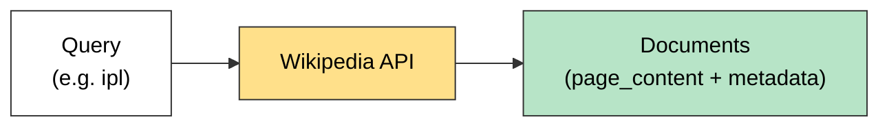

# Wikipedia Retriever

A **Wikipedia Retriever** is a retriever that queries the **Wikipedia API** to fetch relevant content for a given query.

It works a lot like a **document loader**: it gets `Document` objects from an external source (Wikipedia) instead of from your own files.

## How It Works

1. You give it a **query** (e.g. "Albert Einstein").
2. It sends the query to **Wikipedia's API**.
3. It retrieves the **most relevant articles**.
4. It returns them as LangChain **`Document`** objects.



## No Semantic Search: It Is Keyword Matching

- There are **no embeddings and no vector store** involved.
- Wikipedia's own search engine finds the articles by **matching your query words** against article titles and text.
- It does **not** understand meaning. LangChain just passes your query to Wikipedia and wraps the results as Documents.

| | Wikipedia Retriever | Vector store retriever |
|---|---|---|
| Matches by | **Keywords** (text match) | **Meaning** (embeddings) |
| Needs embeddings | No | Yes |
| Data source | Wikipedia (online) | Your own stored chunks |

**What this means for your queries:** use the topic words themselves.

- Good: `"AI agents"`, `"Albert Einstein"`, `"IPL"`
- Weaker: `"articles on Ai Agents"` (a sentence with extra words, which can match poorly)

## Code

```python
from langchain_community.retrievers import WikipediaRetriever
import wikipedia

# Wikipedia may block the library's generic User-Agent, so set your own
wikipedia.set_user_agent("RAGLearningApp/1.0 (your_email@example.com)")

retriever = WikipediaRetriever(top_k_results=2, lang="en")

docs = retriever.invoke("AI agents")

print(len(docs))
print(docs[0].page_content)
print(docs[0].metadata)      # lowercase: metadata
```

| Parameter | Purpose |
|---|---|
| `top_k_results` | How many articles to return |
| `lang` | Wikipedia language edition (e.g. `"en"`) |

## Common Problems

- **`JSONDecodeError: Expecting value`:** Wikipedia rejected the generic User-Agent. Fix it with `wikipedia.set_user_agent(...)`.
- **`AttributeError` on `Meta_Data`:** the attribute is `metadata`, all lowercase.
- Needs an **internet connection**. It does not work offline.

## Quick Summary

Wikipedia Retriever = send a query to the Wikipedia API, get the best-matching articles back as `Document`s. It uses **keyword matching, not semantic search**, so use short, clear topic words as the query.