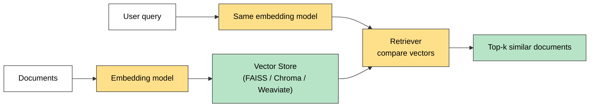

# Vector Store Retriever

A **Vector Store Retriever** in LangChain is the **most common type of retriever**. It searches and fetches documents from a **vector store** based on **semantic similarity** using **vector embeddings**.

## How It Works

1. You store your **documents** in a **vector store** (like FAISS, Chroma, Weaviate).
2. Each document is converted into a **dense vector** using an **embedding model**.
3. When the user enters a **query**:
   - It is also turned into a **vector** (same embedding model).
   - The retriever **compares** the query vector with the stored vectors.
   - It retrieves the **top-k most similar** ones.



> The query and the documents **must use the same embedding model**. Otherwise their vectors are not comparable.

## Semantic Search: It Matches Meaning

Unlike the Wikipedia Retriever (keyword matching), this retriever matches by **meaning**.

| | Wikipedia Retriever | Vector Store Retriever |
|---|---|---|
| Matches by | Keywords | **Meaning** (embeddings) |
| Needs embeddings | No | **Yes** |
| Data source | Wikipedia (online) | Your own stored documents |

## Code

```python
from langchain_chroma import Chroma
from langchain_core.documents import Document
from langchain_google_genai import GoogleGenerativeAIEmbeddings
from dotenv import load_dotenv

load_dotenv()

documents = [
    Document(page_content="LangChain helps developers build LLM applications easily."),
    Document(page_content="Chroma is a vector database optimized for LLM-based search."),
    Document(page_content="Embeddings convert text into high-dimensional vectors."),
]

embeddings = GoogleGenerativeAIEmbeddings(model="gemini-embedding-001")

vector_store = Chroma.from_documents(
    documents=documents,
    embedding=embeddings,
    collection_name="my_collection",
)

# vector store -> retriever
retriever = vector_store.as_retriever(search_kwargs={"k": 2})

res = retriever.invoke("What is Chroma used for?")

for i, doc in enumerate(res):
    print(f"Page Content {i+1} : {doc.page_content}")
    print(f"Metadata {i+1} : {doc.metadata}")
```

| Part | Purpose |
|---|---|
| `as_retriever()` | Turns any vector store into a retriever |
| `search_kwargs={"k": 2}` | Return the top 2 most similar documents |
| `retriever.invoke(query)` | Runs the search and returns a list of `Document`s |

## Quick Summary

Vector Store Retriever = embed documents into a vector store, embed the query the same way, and return the **top-k closest vectors**. It does **semantic search** (meaning), and works with any vector store (FAISS, Chroma, Weaviate, Qdrant, ...).