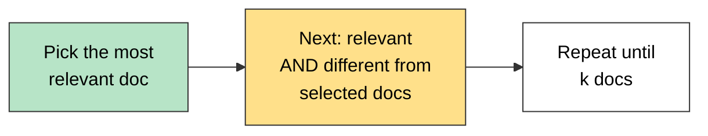

# Maximal Marginal Relevance (MMR)

> **"How can we pick results that are not only relevant to the query but also different from each other?"**

**MMR** is an information retrieval algorithm designed to **reduce redundancy** in the retrieved results while maintaining **high relevance to the query**.

## Why MMR Retriever?

In a **regular similarity search**, you may get documents that are:

- All **very similar to each other**
- **Repeating the same info**
- **Lacking diverse perspectives**

**MMR avoids that by:**

1. Picking the **most relevant document** first.
2. Then picking the next one that is **most relevant** and **least similar** to the already selected docs.
3. And so on...



**Helps in RAG pipelines** where:

- You want the context window to contain **diverse but still relevant information**.
- Documents are **semantically overlapping**.

## Example (from the lecture)

| Doc | Content |
|---|---|
| D1 | Climate change is causing glaciers to melt rapidly in the Arctic region. |
| D2 | Glaciers in the Arctic are melting at an alarming rate due to rising temperatures. |
| D3 | Deforestation in the Amazon is accelerating global climate change. |
| D4 | Climate change is increasing the frequency of wildfires in California. |
| D5 | Rising sea levels due to climate change threaten coastal cities like Mumbai and New York. |

| Method | Top 3 results | Problem / benefit |
|---|---|---|
| **Similarity search** | D1 (Arctic glaciers), D2 (Arctic glaciers), D3 (Deforestation) | D1 and D2 say the **same thing** (redundant) |
| **MMR** | D1 (Arctic glaciers), D4 (Wildfires in California), D5 (Rising sea levels) | **Diverse perspectives**, each doc adds new info |

## How the Score Works

At each step MMR picks the document that maximises:

```
score = λ × (similarity to query) − (1 − λ) × (similarity to already selected docs)
```

- **λ (lambda) = 1:** only relevance, same as normal similarity search.
- **λ = 0:** only diversity.
- Lower λ = more diverse, higher λ = more relevant.

## Code

```python
from langchain_chroma import Chroma

vector_store = Chroma.from_documents(documents, embeddings)

retriever = vector_store.as_retriever(
    search_type="mmr",
    search_kwargs={"k": 3, "lambda_mult": 0.5},
)

res = retriever.invoke("What are the effects of climate change?")
```

| Parameter | Purpose |
|---|---|
| `search_type="mmr"` | Use MMR instead of plain similarity |
| `k` | Number of final results returned |
| `lambda_mult` | Relevance vs diversity balance (0 to 1) |
| `fetch_k` | How many top candidates to fetch first, MMR then picks `k` from these (default 20) |

## Quick Summary

MMR = similarity search **plus a diversity penalty**. It picks the best match first, then keeps choosing docs that are relevant but **different from those already chosen**. Use it when similarity search returns near-duplicate chunks.