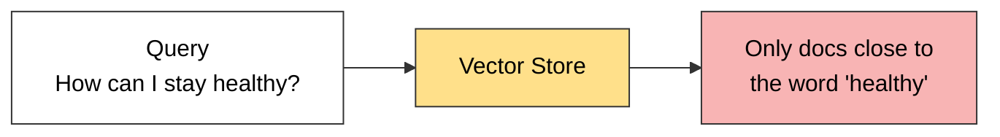
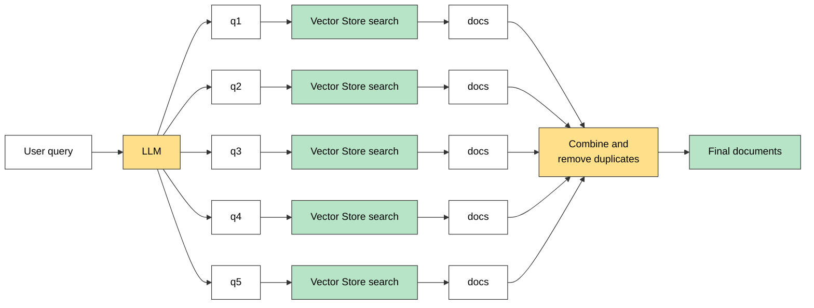

# Multi-Query Retriever

Sometimes a **single query might not capture all the ways information is phrased in your documents.**

## The Problem (example from the lecture)

**Query:** `"How can I stay healthy?"`

Could mean:

- What should I eat?
- How often should I exercise?
- How can I manage stress?

A simple similarity search might **miss documents** that talk about those things but **don't use the word "healthy."**



## How Multi-Query Retriever Works

1. Takes your **original query**.
2. Uses an **LLM** (e.g., GPT-3.5) to generate **multiple semantically different versions** of that query.
3. Performs **retrieval for each sub-query**.
4. **Combines and deduplicates** the results.

## Diagram



### Example: queries the LLM generates for "How can I stay healthy?"

1. What are the best foods to maintain good health?
2. How often should I exercise to stay fit?
3. What lifestyle habits improve mental and physical wellness?
4. How can I boost my immune system naturally?
5. What daily routines support long-term health?

Each one searches the vector store separately (e.g. 5 docs each), then all results are merged and duplicates removed.

## Where Does the Number of Queries Come From?

- It is written in the **prompt text** sent to the LLM (the default says "generate **3** different versions").
- It is **not a parameter**. To change it (e.g. to 5), pass your own prompt to `from_llm(..., prompt=...)`.
- Keep the instruction "separated by newlines", because LangChain splits the LLM reply by lines.

## Code

```python
from langchain_community.vectorstores import FAISS
from langchain_google_genai import GoogleGenerativeAIEmbeddings, ChatGoogleGenerativeAI
from langchain_classic.retrievers.multi_query import MultiQueryRetriever
from dotenv import load_dotenv

load_dotenv()

embedding = GoogleGenerativeAIEmbeddings(model="gemini-embedding-001")
vector_store = FAISS.from_documents(all_docs, embedding)

llm = ChatGoogleGenerativeAI(model="gemini-2.5-flash", temperature=0.7)

multi_query_retriever = MultiQueryRetriever.from_llm(   # use from_llm, not the plain class
    retriever=vector_store.as_retriever(search_kwargs={"k": 2}),
    llm=llm,
)

results = multi_query_retriever.invoke("How to improve energy levels and maintain balance?")
```

| Point | Detail |
|---|---|
| Build it with | `MultiQueryRetriever.from_llm(...)` |
| Why not `MultiQueryRetriever(...)` | The plain class needs a ready-made `llm_chain`, which gives `Field required` |
| Import | `langchain_classic.retrievers.multi_query` (LangChain 1.x moved it out of `langchain`) |
| Needs an LLM | Yes, one extra LLM call per search |

## Common Errors

- **`llm_chain Field required`:** use `from_llm(...)`.
- **`503 UNAVAILABLE ... high demand`:** this is a Google server overload, **not a bug in your code**. Wait and retry, or switch to another Gemini model.

## Multi-Query vs Top-k vs MMR

| | Top-k | MMR | Multi-Query |
|---|---|---|---|
| Search starting points | 1 | 1 | **Several** |
| Fixes | Nothing | Duplicate-like results | Missing docs caused by wording |
| Can find docs outside the first shortlist | No | No | **Yes** |
| Needs an LLM | No | No | **Yes** |

MMR only re-picks from the shortlist (`fetch_k`, default 20) found around **one** query vector. Multi-Query searches from **different** query vectors.

## When to Use

**Use it when:**
- Users ask vague, short or casual questions.
- The topic can be phrased in many ways.
- One question needs information from different sections.

**Skip it when:**
- Queries are already precise (exact product code, error message).
- Speed or API cost matters more.

## Quick Summary

Multi-Query Retriever = an **LLM rewrites the user's query into several versions**, each version searches the vector store, and the results are **merged and deduplicated**. It improves **recall** when one phrasing would miss relevant documents.