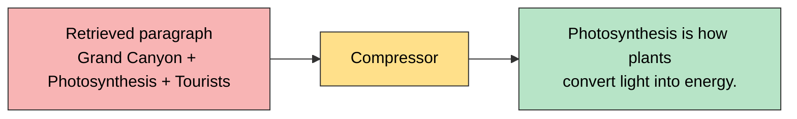
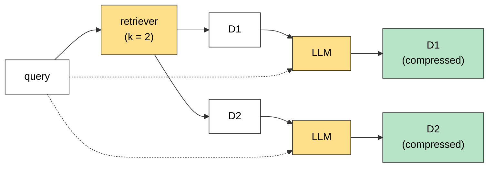

# Contextual Compression Retriever

The **Contextual Compression Retriever** in LangChain is an advanced retriever that improves retrieval quality by **compressing documents after retrieval**, keeping only the **relevant content based on the user's query**.

## Example

**Query:** "What is photosynthesis?"

**Retrieved document (by a traditional retriever):**

> "The Grand Canyon is a famous natural site. **Photosynthesis is how plants convert light into energy.** Many tourists visit every year."

(Handwritten: this paragraph is the kind of chunk a **text splitter** produces, and it is the **result** the retriever returns.)

## Problem

- The retriever returns the **entire paragraph**.
- Only **one sentence** is actually relevant to the query.
- The rest is **irrelevant noise** that wastes the context window and may confuse the LLM.

## What Contextual Compression Retriever Does

Returns **only the relevant part**, e.g.

> "Photosynthesis is how plants convert light into energy."



## How It Works

1. **Base Retriever** (e.g., FAISS, Chroma) retrieves **N documents**.
2. A **compressor** (usually an **LLM**) is applied to **each document**.
3. The compressor keeps **only the parts relevant to the query**.
4. **Irrelevant content is discarded.**

## Diagram (k = 2)



- The LLM is called **separately for each document**, with the **query + that document**.
- If the LLM finds nothing relevant in a document, it returns `NO_OUTPUT` and that document is **dropped**. So you can get fewer than `k` results.

## When to Use

- Your documents are **long and contain mixed information**.
- You want to **reduce context length** for LLMs.
- You need to **improve answer accuracy** in RAG pipelines.

## Code

```python
from langchain_classic.retrievers.contextual_compression import ContextualCompressionRetriever
from langchain_classic.retrievers.document_compressors import LLMChainExtractor
from langchain_community.vectorstores import FAISS
from langchain_google_genai import ChatGoogleGenerativeAI, GoogleGenerativeAIEmbeddings

vector_store = FAISS.from_documents(docs, GoogleGenerativeAIEmbeddings(model="gemini-embedding-001"))

llm = ChatGoogleGenerativeAI(model="gemini-2.5-flash")
compressor = LLMChainExtractor.from_llm(llm)

retriever = ContextualCompressionRetriever(
    base_compressor=compressor,
    base_retriever=vector_store.as_retriever(search_kwargs={"k": 2}),
)

res = retriever.invoke("What is photosynthesis?")
```

| Part | Role |
|---|---|
| `base_retriever` | Finds the N documents first |
| `LLMChainExtractor` | Compressor: LLM keeps only the relevant text of each document |
| `ContextualCompressionRetriever` | Joins the base retriever and the compressor |

## Trade-off

| | Normal retriever | Contextual Compression |
|---|---|---|
| Returns | Whole documents with noise | Only the relevant part |
| Can drop documents | No | Yes (`NO_OUTPUT`) |
| Cost | 1 search | 1 search + **1 LLM call per retrieved document** |

## Quick Summary

Contextual Compression Retriever = **retrieve first, then compress**. An LLM reads each retrieved document and keeps only the parts that matter for the query, so the final LLM gets **less noise and a shorter context**.