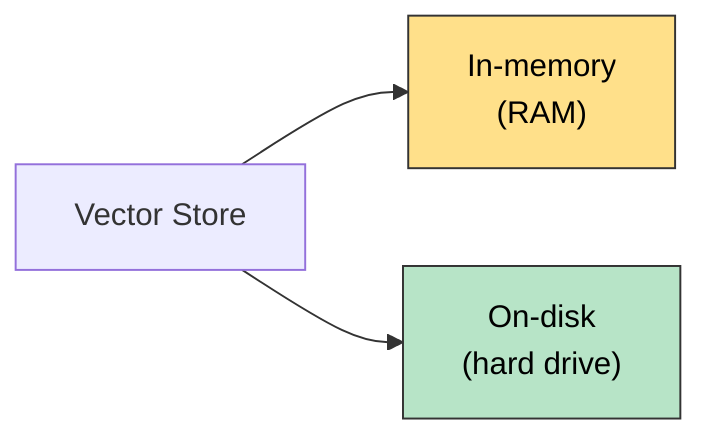
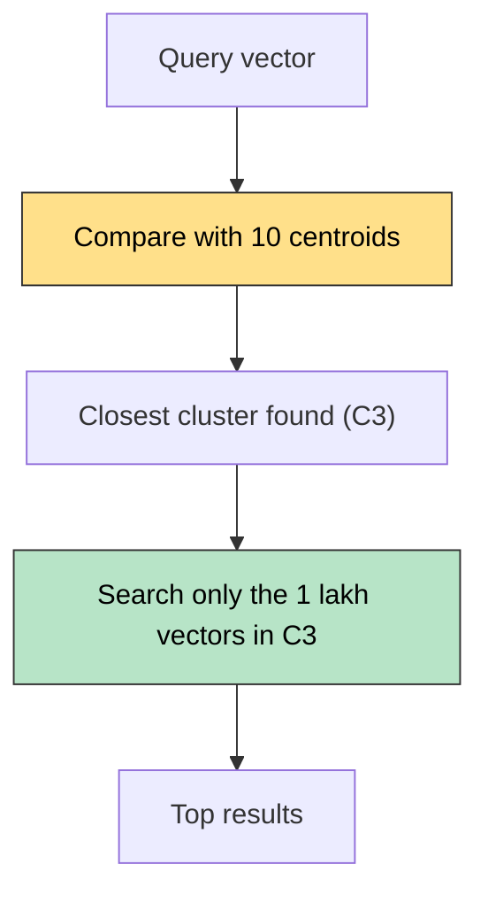

# What are Vector Stores

A **vector store** is a system designed to **store** and **retrieve** data represented as **numerical vectors**.

## Key Features

| # | Feature | Meaning |
|---|---|---|
| 1 | **Storage** | Keeps vectors and their associated **metadata**, either **in-memory** or **on-disk** |
| 2 | **Similarity Search** | Retrieves the vectors most similar to a query vector |
| 3 | **Indexing** | A data structure or method that enables **fast similarity search** on high-dimensional vectors (e.g. approximate nearest neighbour lookups) |
| 4 | **CRUD Operations** | Manage the data lifecycle: add new vectors, read them, update existing entries, remove outdated vectors |

## Storage: In-memory vs On-disk

| | In-memory (RAM) | On-disk (hard drive) |
|---|---|---|
| Speed | Very fast lookups | Slower |
| Durability | Lost when the program ends | Kept after the program ends |
| Best for | Quick experiments | Durable, large-scale use |

## Indexing: Why It Is Needed

**Example:** 10 lakh (1,000,000) vectors, each with 784 dimensions.

**Without an index:** compare the query vector with **every** vector, which is **O(n)**, about 10 lakh comparisons per search. Too slow.

**With an index (clustering):**

1. Group the vectors into **10 clusters** of about 1 lakh each.
2. Each cluster gets a **centroid**: the average of its vectors. So 10 centroid vectors in total.
3. Compare the query only with the **10 centroids**, and pick the closest cluster (for example C3).
4. Search **only inside that cluster** (1 lakh vectors).

| | Comparisons per search |
|---|---|
| No index | 10 lakh |
| Clustering | 10 + 1 lakh, about **10 times fewer** |

**Trade-off:** this is **approximate** search. If the true nearest vector sits in a neighbouring cluster, it can be missed. Speed is gained at a small cost in accuracy, which is why it is called approximate nearest neighbour (ANN).

## Use Cases

1. Semantic search
2. RAG
3. Recommender systems
4. Image / multimedia search

## Quick Summary

A vector store saves vectors and metadata (in RAM or on disk), finds the most similar ones to a query, uses an **index** (like clustering) to avoid comparing against every vector, and supports add, read, update and delete.