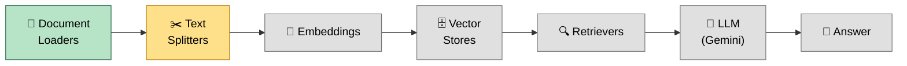
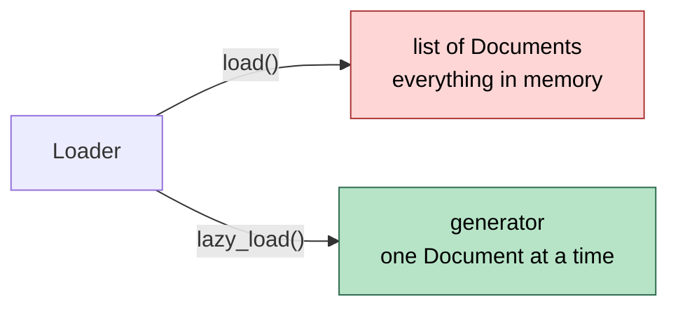
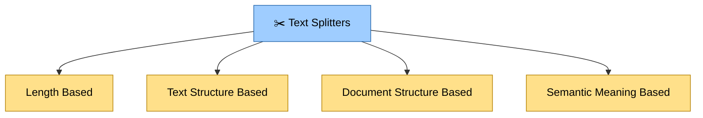
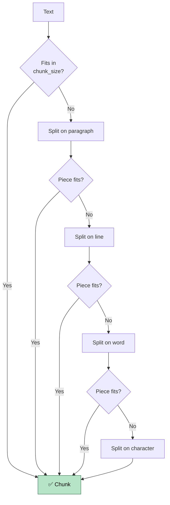

<div align="center">

# 🔗 LangChain RAG Pipeline

**A step-by-step, hands-on journey from raw documents to a working Retrieval-Augmented Generation (RAG) application, built with LangChain and Google Gemini.**


[Overview](#-overview) •
[Pipeline](#-the-rag-pipeline) •
[Repository Map](#-repository-map) •
[Document Loaders](#-1-document-loaders) •
[Text Splitters](#-2-text-splitters) •
[Quick Start](#-quick-start) •
[Roadmap](#-roadmap)

</div>

---

## 📖 Overview

This repository documents my learning of **RAG (Retrieval-Augmented Generation)** one component at a time. Each stage of the pipeline has its own folder with runnable demo scripts and revision notes, and the final goal is a **YouTube chatbot powered by RAG**.

> **Why RAG?** LLMs only know what they were trained on. RAG lets a model answer from **your own documents** by retrieving the most relevant pieces first and handing them to the model as context.

---

## 🧭 The RAG Pipeline

Every folder in this repo maps to one stage of the pipeline below.



🟩 Completed &nbsp;&nbsp; 🟨 In progress &nbsp;&nbsp; ⬜ Planned

---

## 🗺️ Repository Map

Click any folder to jump straight to it.

| Stage | Folder | What's inside |
|---|---|---|
| 1️⃣ Loading | [`LangChain_Docuement_Loaders`](./LangChain_Docuement_Loaders) | Loaders for text, PDFs, directories and the web |
| 2️⃣ Splitting | [`LangChain_Text_Splitters`](./LangChain_Text_Splitters) | Length based and text-structure based splitters |
| 3️⃣ Embeddings | *coming soon* | Turning chunks into vectors |
| 4️⃣ Vector stores | *coming soon* | Storing and searching vectors |
| 5️⃣ Retrievers | *coming soon* | Fetching relevant chunks for a query |
| 🎯 Capstone | *coming soon* | RAG-based YouTube chatbot |

**Root files**

| File | Purpose |
|---|---|
| [`requirements.txt`](./requirements.txt) | All Python dependencies |
| [`.gitignore`](./.gitignore) | Keeps `.venv/` and `.env` (API keys) out of Git |

---

## 📄 1. Document Loaders

📁 **Folder:** [`LangChain_Docuement_Loaders`](./LangChain_Docuement_Loaders)

A loader reads a source and returns a **list of `Document` objects**, each with `page_content` (the text) and `metadata` (source, page, etc.).

| Loader | Demo folder | Documents returned |
|---|---|---|
| `TextLoader` | [`LangChain_TextLoader`](./LangChain_Docuement_Loaders/LangChain_TextLoader) | 1 per file |
| `PyPDFLoader` | [`LangChain_PDFLoader`](./LangChain_Docuement_Loaders/LangChain_PDFLoader) | 1 per **page** |
| `DirectoryLoader` | [`LangChain_DIrectoryLoader`](./LangChain_Docuement_Loaders/LangChain_DIrectoryLoader) | 1 per file / page, using a glob pattern |
| `WebBaseLoader` | see the loaders folder | 1 per URL |

### ⚡ `load()` vs `lazy_load()`

📁 [`LangChain_Load_LazyLoad`](./LangChain_Docuement_Loaders/LangChain_Load_LazyLoad) (includes revision notes)



| | `load()` | `lazy_load()` |
|---|---|---|
| Style | Eager | Lazy |
| Returns | `list` | `generator` |
| Memory | All documents at once | One at a time |
| Best for | Few documents | Many or large files |

### 🔎 Glob patterns for `DirectoryLoader`

| Pattern | Loads |
|---|---|
| `**/*.txt` | All `.txt` files in all subfolders |
| `*.pdf` | All `.pdf` files in the root directory |
| `data/*.csv` | All `.csv` files in the `data/` folder |
| `**/*` | All files, all folders |

> `**` means recursive search through subfolders.

---

## ✂️ 2. Text Splitters

📁 **Folder:** [`LangChain_Text_Splitters`](./LangChain_Text_Splitters)

LLMs and embedding models have **input limits**, so large text is split into smaller **chunks** before embedding. Smaller chunks give more accurate vectors, cleaner search results, and lower memory use.



### Length based: `CharacterTextSplitter`

Cuts text at a fixed size. **Fast and simple**, but it ignores grammar, so words and sentences can be cut in half and the resulting embeddings carry incomplete meaning.

### Text structure based: `RecursiveCharacterTextSplitter`

Tries natural boundaries first (paragraph, then line, then word, then character), splitting only what is too big and merging small pieces back up to `chunk_size`.



### 🔁 Chunk overlap

Characters repeated between neighbouring chunks, so meaning isn't lost at a cut.

```
Text: ABCDEFGHIJKLMNOPQRST   (chunk_size=10, chunk_overlap=3)

Chunk 1: ABCDEFGHIJ
Chunk 2:        HIJKLMNOPQ     <- starts with HIJ (the overlap)
Chunk 3:               OPQRST
```

⚠️ **Trade-off:** more overlap means more chunks, which means more embeddings, storage and computation. Keep it around 10-20% of `chunk_size`.

### 🧪 Visualize your chunks

Want to *see* how `chunk_size` and `chunk_overlap` change the splits? Try the interactive tool:

👉 **[ChunkViz: chunk visualizer](https://chunkviz.up.railway.app/)**

Paste a piece of text, adjust the size and overlap, and watch the chunk boundaries move in real time.

### Two splitting functions

| Function | Input | Output |
|---|---|---|
| `split_text(text)` | A plain string | `list[str]` |
| `split_documents(docs)` | `list[Document]` from a loader | `list[Document]`, metadata kept on every chunk |

---

## 🚀 Quick Start

**1. Clone the repo**

```bash
git clone https://github.com/Og-Brutal/langchain-rag-pipeline.git
cd langchain-rag-pipeline
```

**2. Create and activate a virtual environment**

```bash
python3 -m venv .venv
source .venv/bin/activate          # Linux / macOS
# .venv\Scripts\activate           # Windows
```

**3. Install dependencies**

```bash
pip install -r requirements.txt
```

**4. Add your Gemini API key**

Create a `.env` file in the project root:

```env
GOOGLE_API_KEY=your_api_key_here
```

Get a key from [Google AI Studio](https://aistudio.google.com/apikey). The `.env` file is already in `.gitignore`, so it won't be committed.

**5. Run any demo**

```bash
cd LangChain_Docuement_Loaders/LangChain_PDFLoader
python3 PDFLoader.py
```

> 💡 If your path contains spaces, wrap it in quotes: `cd "/path/with spaces/project"`.

---

## 🧰 Tech Stack

| Tool | Role |
|---|---|
| [LangChain](https://python.langchain.com/) | Framework for building LLM applications |
| [Google Gemini](https://ai.google.dev/) | LLM, via `langchain-google-genai` |
| `pypdf` | PDF text extraction |
| `beautifulsoup4` + `requests` | Web page loading |
| `python-dotenv` | Loads API keys from `.env` |

---

## 🛣️ Roadmap

- [x] Document loaders (text, PDF, directory, web)
- [x] `load()` vs `lazy_load()`
- [x] Text splitters: length based
- [x] Text splitters: text-structure based (recursive)
- [ ] Text splitters: document structure based
- [ ] Text splitters: semantic meaning based
- [ ] Embeddings
- [ ] Vector stores
- [ ] Retrievers
- [ ] 🎯 RAG-based YouTube chatbot

---

## 🤝 Notes

This is a learning project, so each folder is kept small and focused: one concept, one demo, one set of notes. Feedback and suggestions are welcome through [Issues](https://github.com/Og-Brutal/langchain-rag-pipeline/issues).

<div align="center">

**Built by [Abdul Wahab](https://github.com/Og-Brutal)** · ⭐ Star the repo if it helped you learn!

[⬆ Back to top](#-langchain-rag-pipeline)

</div>