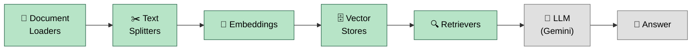
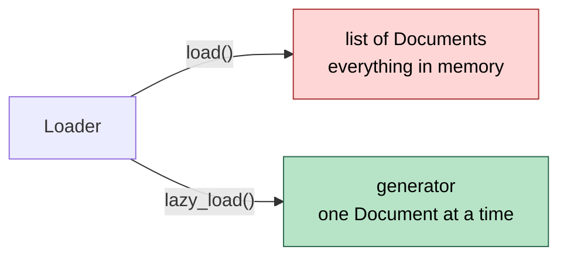
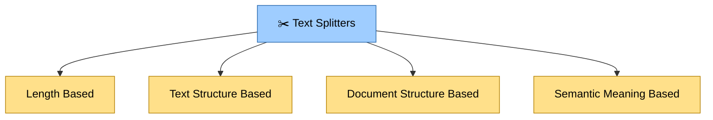
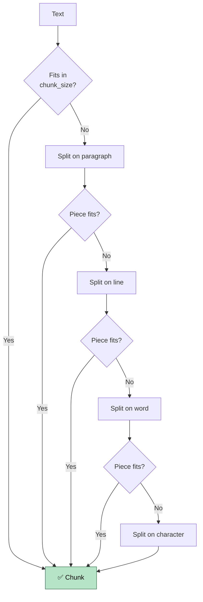
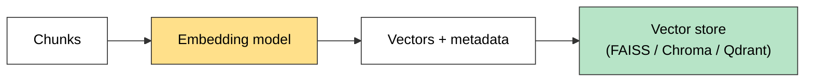
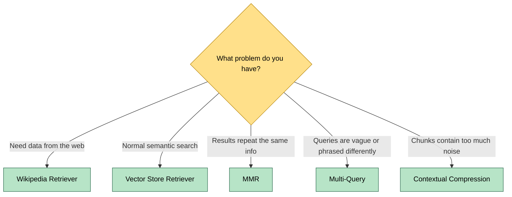

<div align="center">

# 🔗 LangChain RAG Pipeline

**A step-by-step, hands-on journey through every stage of Retrieval-Augmented Generation (RAG): from raw documents to retrievers, built with LangChain and Google Gemini.**


[Overview](#-overview) •
[Pipeline](#-the-rag-pipeline) •
[Folder Structure](#-folder-structure) •
[Loaders](#-1-document-loaders) •
[Splitters](#-2-text-splitters) •
[Vector Stores](#-3-embeddings-and-vector-stores) •
[Retrievers](#-4-retrievers) •
[Quick Start](#-quick-start)

</div>

---

## 📖 Overview

This repository documents my learning of **RAG (Retrieval-Augmented Generation)**, one component at a time. Every stage of the pipeline has its own folder with **runnable demo scripts** and **short revision notes**.

> **Why RAG?** LLMs only know what they were trained on. RAG lets a model answer from **your own documents** by retrieving the most relevant pieces first and handing them to the model as context.

✅ **The core pipeline is now complete:** document loaders → text splitters → embeddings → vector stores → retrievers.

---

## 🧭 The RAG Pipeline

Every folder in this repo maps to one stage of the pipeline below.



🟩 Covered in this repo &nbsp;&nbsp; ⬜ Used inside the demos (Gemini LLM)

---

## 🗂️ Folder Structure

Click any folder to jump straight to it.

```text
langchain-rag-pipeline/
│
├── 📄 LangChain_Docuement_Loaders/          # Stage 1: loading data
│   ├── LangChain_TextLoader/
│   ├── LangChain_PDFLoader/
│   ├── LangChain_DIrectoryLoader/
│   ├── LangChain_CSVLoader/
│   ├── LangChain_WebBasedLoader/
│   └── LangChain_Load_LazyLoad/
│
├── ✂️ LangChain_Text_Splitters/             # Stage 2: chunking
│   ├── LangChain_Length_Based_Text_Splitter/
│   ├── LangChain_Text_Structure_Based_Text_Splitter/
│   ├── LangChain_Document_Structure_Based_Text_Spliter/
│   └── LangChain_Semantica_Text_SPlitter/
│
├── 🗄️ LangChain_Vector_Store_DataBases/     # Stage 3: embeddings + vector stores
│
├── 🔍 LangChain_Retrievers/                 # Stage 4: fetching relevant chunks
│   ├── LangChain_Wikipedia_Retriever/
│   ├── LangChain_Vector_Store_Retriever/
│   ├── LangChain_MMR_Retriever/
│   ├── LangChain_Multi_Query_Retriever/
│   └── LangChain_Contextual_Compression_Retriever/
│
├── requirements.txt
├── .gitignore
└── README.md
```

| Stage | Folder | What's inside |
|---|---|---|
| 1️⃣ Loading | [`LangChain_Docuement_Loaders`](./LangChain_Docuement_Loaders) | Loaders for text, PDF, directory, CSV and web pages |
| 2️⃣ Splitting | [`LangChain_Text_Splitters`](./LangChain_Text_Splitters) | Length based, text-structure, document-structure and semantic splitters |
| 3️⃣ Embeddings + Vector stores | [`LangChain_Vector_Store_DataBases`](./LangChain_Vector_Store_DataBases) | Vector store theory notes and a Qdrant notebook |
| 4️⃣ Retrievers | [`LangChain_Retrievers`](./LangChain_Retrievers) | Five retriever types, each with a demo and notes |

**Root files**

| File | Purpose |
|---|---|
| [`requirements.txt`](./requirements.txt) | All Python dependencies |
| [`.gitignore`](./.gitignore) | Keeps `.venv/` and `.env` (API keys) out of Git |

---

## 📄 1. Document Loaders

📁 **Folder:** [`LangChain_Docuement_Loaders`](./LangChain_Docuement_Loaders)

A loader reads a source and returns a **list of `Document` objects**, each with `page_content` (the text) and `metadata` (source, page, etc.).

| Loader | Demo folder | Documents returned |
|---|---|---|
| `TextLoader` | [`LangChain_TextLoader`](./LangChain_Docuement_Loaders/LangChain_TextLoader) | 1 per file |
| `PyPDFLoader` | [`LangChain_PDFLoader`](./LangChain_Docuement_Loaders/LangChain_PDFLoader) | 1 per **page** |
| `DirectoryLoader` | [`LangChain_DIrectoryLoader`](./LangChain_Docuement_Loaders/LangChain_DIrectoryLoader) | 1 per file / page, using a glob pattern |
| `CSVLoader` | [`LangChain_CSVLoader`](./LangChain_Docuement_Loaders/LangChain_CSVLoader) | 1 per **row** |
| `WebBaseLoader` | [`LangChain_WebBasedLoader`](./LangChain_Docuement_Loaders/LangChain_WebBasedLoader) · [Notes](./LangChain_Docuement_Loaders/LangChain_WebBasedLoader/Notes.md) | 1 per URL |

### ⚡ `load()` vs `lazy_load()`

📁 [`LangChain_Load_LazyLoad`](./LangChain_Docuement_Loaders/LangChain_Load_LazyLoad) · [Notes](./LangChain_Docuement_Loaders/LangChain_Load_LazyLoad/Notes.md)



| | `load()` | `lazy_load()` |
|---|---|---|
| Style | Eager | Lazy |
| Returns | `list` | `generator` |
| Memory | All documents at once | One at a time |
| Best for | Few documents | Many or large files |

### 🔎 Glob patterns for `DirectoryLoader`

| Pattern | Loads |
|---|---|
| `**/*.txt` | All `.txt` files in all subfolders |
| `*.pdf` | All `.pdf` files in the root directory |
| `data/*.csv` | All `.csv` files in the `data/` folder |
| `**/*` | All files, all folders |

> `**` means recursive search through subfolders.

---

## ✂️ 2. Text Splitters

📁 **Folder:** [`LangChain_Text_Splitters`](./LangChain_Text_Splitters) · [Overview notes](./LangChain_Text_Splitters/Notes.md)

LLMs and embedding models have **input limits**, so large text is split into smaller **chunks** before embedding. Smaller chunks give more accurate vectors, cleaner search results, and lower memory use.

| Type | Splitter | Demo + notes |
|---|---|---|
| Length based | `CharacterTextSplitter` | [`LangChain_Length_Based_Text_Splitter`](./LangChain_Text_Splitters/LangChain_Length_Based_Text_Splitter) |
| Text structure based | `RecursiveCharacterTextSplitter` | [`LangChain_Text_Structure_Based_Text_Splitter`](./LangChain_Text_Splitters/LangChain_Text_Structure_Based_Text_Splitter) |
| Document structure based | `RecursiveCharacterTextSplitter.from_language` | [`LangChain_Document_Structure_Based_Text_Spliter`](./LangChain_Text_Splitters/LangChain_Document_Structure_Based_Text_Spliter) |
| Semantic meaning based | `SemanticChunker` | [`LangChain_Semantica_Text_SPlitter`](./LangChain_Text_Splitters/LangChain_Semantica_Text_SPlitter) |



### Length based: `CharacterTextSplitter`

Cuts text at a fixed size. **Fast and simple**, but it ignores grammar, so words and sentences can be cut in half.

### Text structure based: `RecursiveCharacterTextSplitter`

Tries natural boundaries first (paragraph, then line, then word, then character), splitting only what is too big and merging small pieces back up to `chunk_size`.



### Document structure based

The same recursive splitter, but with **format-specific separators** (Markdown headings, `class` / `def` in code) tried first, so a section or function stays together.

### Semantic meaning based: `SemanticChunker`

Embeds every sentence and **cuts where the meaning changes** (a big jump in distance between neighbouring sentences). It lives in `langchain-experimental`.

### 🔁 Chunk overlap

Characters repeated between neighbouring chunks, so meaning isn't lost at a cut.

```text
Text: ABCDEFGHIJKLMNOPQRST   (chunk_size=10, chunk_overlap=3)

Chunk 1: ABCDEFGHIJ
Chunk 2:        HIJKLMNOPQ     <- starts with HIJ (the overlap)
Chunk 3:               OPQRST
```

⚠️ **Trade-off:** more overlap means more chunks, which means more embeddings, storage and computation. Keep it around 10-20% of `chunk_size`.

### 🧪 Visualize your chunks

👉 **[ChunkViz: chunk visualizer](https://chunkviz.up.railway.app/)**: paste text, adjust size and overlap, and watch the chunk boundaries move in real time.

### Two splitting functions

| Function | Input | Output |
|---|---|---|
| `split_text(text)` | A plain string | `list[str]` |
| `split_documents(docs)` | `list[Document]` from a loader | `list[Document]`, metadata kept on every chunk |

---

## 🗄️ 3. Embeddings and Vector Stores

📁 **Folder:** [`LangChain_Vector_Store_DataBases`](./LangChain_Vector_Store_DataBases)

| File | What it is |
|---|---|
| [`Notes.md`](./LangChain_Vector_Store_DataBases/Notes.md) | Vector store theory: indexing, in-memory vs on-disk, vector store vs vector database, the LangChain common interface |
| [`LangChain_Qdrant_Vector_Store_updated .ipynb`](./LangChain_Vector_Store_DataBases/LangChain_Qdrant_Vector_Store_updated%20.ipynb) | Hands-on Qdrant notebook (create a collection, add documents, search, scroll through stored points) |

**Embeddings:** text chunks become vectors using `GoogleGenerativeAIEmbeddings(model="gemini-embedding-001")` in the demos.



| Store | Where it is used |
|---|---|
| **FAISS** | Retriever demos (in-memory) |
| **Chroma** | [Vector Store Retriever](./LangChain_Retrievers/LangChain_Vector_Store_Retriever) |
| **Qdrant** | [Qdrant notebook](./LangChain_Vector_Store_DataBases) (local, on-disk) |

---

## 🔍 4. Retrievers

📁 **Folder:** [`LangChain_Retrievers`](./LangChain_Retrievers)

A retriever takes a **query** and returns the most relevant **`Document`s**. Each folder has a runnable demo and revision notes.

| Retriever | Idea in one line | Demo + notes |
|---|---|---|
| **Wikipedia** | Queries the Wikipedia API (**keyword matching**, no semantic search) | [`LangChain_Wikipedia_Retriever`](./LangChain_Retrievers/LangChain_Wikipedia_Retriever) · [Notes](./LangChain_Retrievers/LangChain_Wikipedia_Retriever/Notes.md) |
| **Vector Store** | Embeds the query and returns the **top-k** closest chunks | [`LangChain_Vector_Store_Retriever`](./LangChain_Retrievers/LangChain_Vector_Store_Retriever) · [Notes](./LangChain_Retrievers/LangChain_Vector_Store_Retriever/Notes.md) |
| **MMR** | Relevant **and diverse**, reduces duplicate-like results | [`LangChain_MMR_Retriever`](./LangChain_Retrievers/LangChain_MMR_Retriever) · [Notes](./LangChain_Retrievers/LangChain_MMR_Retriever/Notes.md) |
| **Multi-Query** | An LLM rewrites the query into several versions, then merges the results | [`LangChain_Multi_Query_Retriever`](./LangChain_Retrievers/LangChain_Multi_Query_Retriever) · [Notes](./LangChain_Retrievers/LangChain_Multi_Query_Retriever/Notes.md) |
| **Contextual Compression** | Retrieves first, then an LLM keeps **only the relevant part** of each chunk | [`LangChain_Contextual_Compression_Retriever`](./LangChain_Retrievers/LangChain_Contextual_Compression_Retriever) · [Notes](./LangChain_Retrievers/LangChain_Contextual_Compression_Retriever/Notes.md) |

### Which one should I use?



| | Searches by | Needs an LLM | Extra cost |
|---|---|---|---|
| Wikipedia | Keywords | No | Network call |
| Vector Store | Meaning (embeddings) | No | None |
| MMR | Meaning + diversity | No | None |
| Multi-Query | Meaning, several phrasings | **Yes** | +1 LLM call per search |
| Contextual Compression | Meaning, then trimmed | **Yes** | +1 LLM call **per retrieved chunk** |

---

## 🚀 Quick Start

**1. Clone the repo**

```bash
git clone https://github.com/Og-Brutal/langchain-rag-pipeline.git
cd langchain-rag-pipeline
```

**2. Create and activate a virtual environment**

```bash
python3 -m venv .venv
source .venv/bin/activate          # Linux / macOS
# .venv\Scripts\activate           # Windows
```

**3. Install dependencies**

```bash
pip install -r requirements.txt
```

**4. Add your Gemini API key**

Create a `.env` file in the project root:

```env
GOOGLE_API_KEY=your_api_key_here
```

Get a key from [Google AI Studio](https://aistudio.google.com/apikey). The `.env` file is already in `.gitignore`, so it won't be committed.

**5. Run any demo** (from inside its own folder, because some demos use relative file paths)

```bash
cd LangChain_Retrievers/LangChain_MMR_Retriever
python3 LangChain_MMR_Retriever.py
```

> 💡 If your path contains spaces, wrap it in quotes: `cd "/path/with spaces/project"`.

### 🩺 Troubleshooting

| You see | Meaning / fix |
|---|---|
| `DeprecationWarning: langchain-community is being sunset` | Harmless warning, the code still runs |
| `503 UNAVAILABLE ... high demand` | Google's servers are busy. Wait and retry, or switch Gemini model |
| `np.float_ was removed in NumPy 2.0` (Chroma) | Old `chromadb`. Run `pip install -U chromadb langchain-chroma` |
| `JSONDecodeError` from the Wikipedia retriever | Set a custom user agent: `wikipedia.set_user_agent("YourApp/1.0 (you@example.com)")` |
| `ModuleNotFoundError: langchain_classic` | `pip install langchain-classic` |

---

## 🧰 Tech Stack

| Tool | Role |
|---|---|
| [LangChain](https://python.langchain.com/) | Framework for building LLM applications |
| [Google Gemini](https://ai.google.dev/) | LLM and embeddings, via `langchain-google-genai` |
| [FAISS](https://github.com/facebookresearch/faiss) | In-memory vector search |
| [Chroma](https://www.trychroma.com/) | Vector store (`langchain-chroma`) |
| [Qdrant](https://qdrant.tech/) | Vector database (`langchain-qdrant`, `qdrant-client`) |
| `pypdf` | PDF text extraction |
| `beautifulsoup4` + `requests` | Web page loading |
| `wikipedia` | Wikipedia retriever backend |
| `python-dotenv` | Loads API keys from `.env` |

---

## 🛣️ Roadmap

- [x] Document loaders (text, PDF, directory, CSV, web)
- [x] `load()` vs `lazy_load()`
- [x] Text splitters (length, text-structure, document-structure, semantic)
- [x] Embeddings
- [x] Vector stores (FAISS, Chroma, Qdrant)
- [x] Retrievers (Wikipedia, Vector Store, MMR, Multi-Query, Contextual Compression)
- [ ] Next: end-to-end RAG chains in a separate repository

---

## 🤝 Notes

This is a learning project, so each folder is kept small and focused: one concept, one demo, one set of notes. Feedback and suggestions are welcome through [Issues](https://github.com/Og-Brutal/langchain-rag-pipeline/issues).

<div align="center">

**Built by [Abdul Wahab](https://github.com/Og-Brutal)** · ⭐ Star the repo if it helped you learn!

[⬆ Back to top](#-langchain-rag-pipeline)

</div>